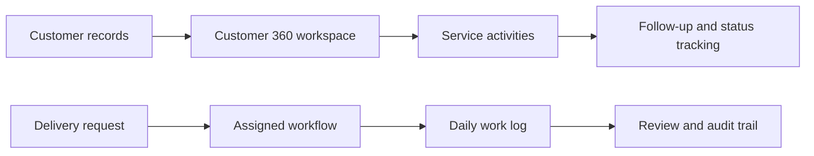

# Odoo ERP Workflow Modules

An anonymized portfolio case study covering two Odoo ERP extensions I developed for business operations: a customer-service workspace and a delivery/work-management workflow.

No client name, production URL, employee record, customer record, or proprietary database export is included in this repository.

## Case studies

- [Customer 360 & service workspace](docs/customer-service-workspace.md)
- [Delivery workflow & daily work log](docs/delivery-workflow.md)

## Functional map

## My role

- Requirements analysis and workflow design
- Odoo model and view development
- Customer-service workspace implementation
- Delivery and daily-work workflow implementation
- Integration, validation, and iterative improvement

## Portfolio boundary

The original screenshots contain identifiable enterprise data, so they are deliberately not published. The documentation describes the architecture and engineering contribution using generic terminology.
